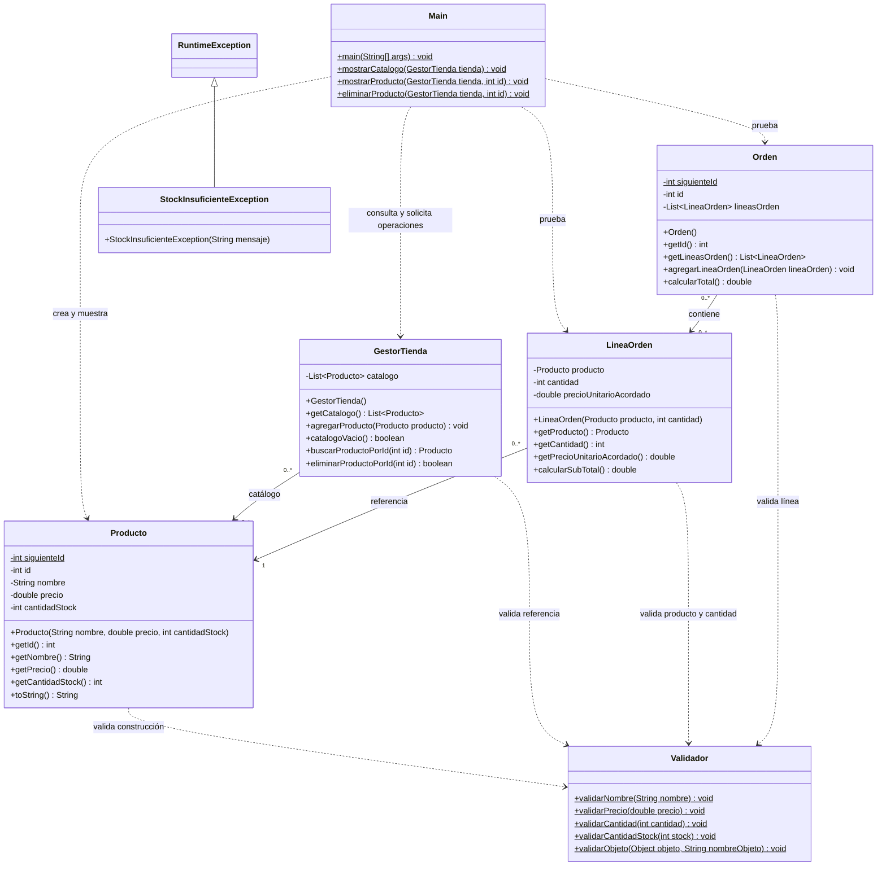

# UML de la preentrega

Actualizado el 11 de octubre de 2026 a partir del código local. El diagrama representa lo implementado; las funcionalidades pendientes se registran debajo.

## Lectura y decisiones actuales

- `+` indica público, `-` privado y `$` miembro estático. Los IDs de Producto y Orden son finales; sus contadores son compartidos y se reinician al ejecutar el programa.
- Paquetes: Main en `com.techlab`; las otras clases en `gestion`, `productos`, `ordenes`, `util` y `excepciones` bajo esa raíz.
- Main presenta información; GestorTienda administra el catálogo. Actualmente Main contiene pruebas, no un menú interactivo.
- Los getters de catálogo y líneas devuelven listas nuevas que contienen referencias a los mismos objetos.
- Se utilizan asociaciones, sin rombos de composición: el código permite compartir productos e incluso la misma línea entre órdenes. No se impone propiedad exclusiva.
- Una orden puede empezar vacía. Su total suma subtotales calculados con el precio acordado al construir cada línea.
- Nombre no nulo ni vacío tras trim; precio y stock no negativos; cantidad de línea mayor que cero; referencias agregadas no nulas.
- Validar el nombre con trim no lo normaliza al guardarlo: el código actual de Producto asigna `this.nombre = nombre`.
- StockInsuficienteException está definida, pero todavía no se lanza desde una operación de venta.

## Pendiente de implementación

- Menú repetitivo y lectura de datos con manejo de entradas inválidas.
- Confirmación coordinada por GestorTienda, con descuento controlado mediante Producto. Las firmas todavía no están acordadas ni implementadas.
- Rechazar orden nula o vacía; comprobar pertenencia de los productos al catálogo y stock suficiente para toda la orden antes de descontar cualquier cantidad.
- Contemplar cantidades acumuladas de productos repetidos. Se pospuso elegir entre reunir líneas o sumar cantidades al validar.
- Impedir confirmar dos veces la misma orden; definir cómo controlar su estado y sus cambios después de confirmar.
- La fecha, búsqueda por nombre, actualización de productos y listado histórico quedan fuera del alcance inmediato.

Las reglas pendientes no se representan como métodos existentes. La asociación GestorTienda–Orden se incorporará al diagrama cuando se implemente la coordinación.
